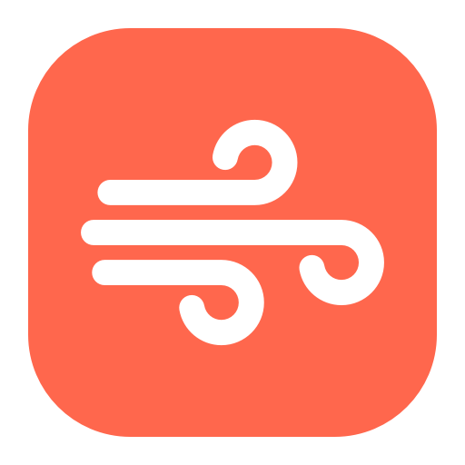

<p align="center"></p>

<h1 align="center">Cruft</h1>

<p align="center"><strong>Make room for what matters.</strong></p>

<p align="center"><strong>English</strong> · <a href="README.zh-Hans.md">简体中文</a> · <a href="README.zh-Hant.md">繁體中文</a><br />
<a href="https://github.com/dofy/Cruft">GitHub</a> · <a href="https://github.com/dofy/Cruft/issues">Issues</a></p>

<p align="center">
  
  
  
  
  
</p>

[Cruft](https://cruft.phpz.org) is a small native **macOS app** that clears the *cruft* a developer machine piles
up — Xcode DerivedData, toolchain caches (npm/pnpm/yarn, Cargo, Go, Gradle,
Maven, pip, SwiftPM), system caches, logs, Homebrew/CocoaPods/gem leftovers, and
the Trash — plus scanners for stale project build artifacts and leftover
installers. Checklist UI, per-task size estimates, and a report of the space
reclaimed.

## What it does

Six panes in a native sidebar: **Clean**, **Build products**, **Installers**,
**App cleanup**, **Background apps**, and **Restore history**.

### Clean pane

Pick exactly what to run. Every task is a toggle. Tasks whose CLI tool is missing
(`brew`, `mas`, `pod`, `gem`, `pnpm`, `go`) grey out; toolchain-cache rows only
appear when that toolchain's cache directory actually exists.

#### Update — *off by default*

| Task | Runs |
|------|------|
| Homebrew | `brew update` + `upgrade` + `upgrade --cask --greedy` |
| App Store apps | `mas upgrade` |

#### Developer caches — *on by default (except Maven)*

| Task | Target |
|------|--------|
| npm | `~/.npm/_cacache` |
| pnpm | `pnpm store prune` |
| yarn | `~/Library/Caches/Yarn` |
| Cargo | `~/.cargo/registry/{cache,src}` |
| Go | `go clean -cache -modcache` (modcache is read-only, so cleaned via `go`) |
| Gradle | `~/.gradle/caches` |
| Maven | `~/.m2/repository` — *off by default* (full re-download is costly) |
| pip | `~/Library/Caches/pip` |
| SwiftPM | `~/Library/Caches/org.swift.swiftpm` |

#### Clean — *on by default*

| Task | Target |
|------|--------|
| CocoaPods cache | `pod cache clean --all` |
| Xcode | DerivedData, Archives, Products, unavailable simulators, old iOS DeviceSupport (keeps latest) |
| System caches | `~/Library/Caches` |
| Application logs | `~/Library/Logs` |
| Trash | `~/.Trash` |
| Homebrew | `brew cleanup` |
| Ruby gems | `gem cleanup` |

Network/update tasks start unchecked; local cleanup tasks start checked.

### Project artifacts pane

Scans `~/Works`, `~/Projects`, `~/Developer` for build/dependency directories
(`node_modules`, `.next`, `dist`, `build`, `target`, `.build`, `venv`, `.venv`,
`vendor`, `Pods`, `DerivedData`), listing each with size and last-modified age.
Projects touched within the last 7 days start **unselected** to avoid nuking an
active tree. Selected items go to the **Trash** (recoverable), not a hard delete.

### Installers pane

Scans `~/Downloads` and `~/Desktop` for leftover `.dmg` / `.pkg` files. All start
unselected — you confirm each. Selected items go to the **Trash**.

### Applications pane

Scans `/Applications` and `~/Applications`, then checks selected apps against
known user-level Library locations. Exact bundle-ID matches start selected;
name-only matches are shown as lower-confidence candidates and start unselected.
The app bundle and confirmed related files move to the Trash together.

Cruft does not install a privileged helper. Apps protected by administrator
ownership are reported as failures instead of triggering an elevated deletion.

### Recovery history

File-based cleanup, project artifacts, installers, and application cleanup save
the original and trashed paths in
`~/Library/Application Support/Cruft/deletion-history.json`. A batch can be
restored while its files remain in the Trash. Existing files at the original
path are never overwritten.

Command-based jobs (`brew`, package-manager commands, `simctl`, Docker prune)
and emptying the Trash remain non-recoverable.

## Interface

- **Size estimates** — each cleanable directory shows its current disk usage,
  computed in the background and re-estimated after a run.
- **Per-task details** — an ⓘ button on every row opens a popover listing the
  exact paths / commands that task touches.
- **Collapsible log** — a console pane (collapsed by default, auto-expands during
  a run) streams task output live.
- **Freed-space report** — the footer shows how much was reclaimed.
- **Confirmation gate** — every cleanup run must be confirmed and explains which
  operations are recoverable.
- **Operation history** — each Clean run is appended to
  `~/Library/Logs/Cruft/operations.log` (timestamp, freed bytes, tasks).
- **Native maintenance-console UI** — resizable sidebar navigation, storage gauge,
  grouped surfaces, system materials, SF Symbols, and light/dark mode support.
- **Central permission gate** — startup checks Full Disk Access without enumerating
  cleanup folders. Until access is granted, scanning and cleanup stay paused behind
  one in-app permission reminder.

## Localization

The UI ships in English, Simplified Chinese and Traditional Chinese, following
the system language. There is no in-app language picker — set it per app under
System Settings → General → Language & Region.

- Source language is `en`. Every `defaultValue` in the Swift code is English.
- Copy lives in `Sources/Localizable.xcstrings`; the Full Disk Access and folder
  usage descriptions live in `Sources/InfoPlist.xcstrings` (the English base
  comes from the `INFOPLIST_KEY_*` entries in `project.yml`).
- `./Scripts/check-localization.sh` (also a CI step) fails on a missing key, a
  missing translation, an orphaned catalog entry, or Chinese hardcoded in Swift.
- Enum raw values that double as `Identifiable.id` (`CleanupCategory`,
  `AppMatchConfidence`) are stable ASCII identifiers, never display text.
- `deletion-history.json` stores **keys** (`titleKey`, `taskKeys`) alongside the
  text, so a restore point written in one language still renders in whatever
  language you switch to. Records written before this change have no keys and
  fall back to the text they were saved with.
- `~/Library/Logs/Cruft/operations.log` is a diagnostic log and stays in a fixed
  English format regardless of UI language.

## Safety

- File-based Clean-pane deletions move to the Trash through Swift's
  `FileManager`; a single protected file is skipped instead of aborting the run.
- Scanner-pane deletions (project artifacts, installers) move to the **Trash**
  via `trashItem`, so they are recoverable until the Trash is emptied.
- Cleanup targets stay in user-owned locations (`~/Library/...`, `~/.Trash`,
  home-directory caches). The Applications pane may also move an explicitly
  selected app bundle from `/Applications`; it never scans or removes broad
  system directories such as `/Library` or `/System`.
- Cruft requests **Full Disk Access** because macOS protects app data, logs,
  Downloads, Desktop, and Trash separately. The permission is managed by macOS;
  Cruft does not scan those locations before the permission check succeeds.
- The app is **not sandboxed** — it needs to invoke `brew`/`mas`/`pod`/`gem`/
  `go`/`pnpm`/`xcrun` and delete cache files in your home directory.

## Build & Run

Requires Xcode 16+ and [xcodegen](https://github.com/yonaskolb/XcodeGen)
(`brew install xcodegen`). Regenerate the checked-in `.xcodeproj` after editing
`project.yml`.

```bash
xcodegen generate                # regenerate Cruft.xcodeproj
open Cruft.xcodeproj             # then Run (⌘R) in Xcode
```

Or from the command line:

```bash
xcodebuild -project Cruft.xcodeproj -scheme Cruft -configuration Release build
```

Tests and the localization gate:

```bash
xcodebuild test -project Cruft.xcodeproj -scheme Cruft \
  -destination 'platform=macOS' CODE_SIGNING_ALLOWED=NO
./Scripts/check-localization.sh
```

To install the build into `/Applications`:

```bash
./Scripts/install-local.sh
```

Use the script rather than copying the build yourself. `project.yml` signs
ad-hoc, and TCC can only pin an ad-hoc signature to the binary's cdhash, so a
Full Disk Access grant silently stops applying as soon as the app is rebuilt —
the toggle stays on and the app still reports no file access. The script signs
with a self-signed `Cruft Local Development` certificate (created in the login
keychain on first run), which TCC pins instead, so the grant survives rebuilds.

### Packaging a build for someone else

```bash
./Scripts/package-release.sh          # → dist/Cruft-<version>.dmg
```

The script builds Release as an Apple Silicon (`arm64`) binary, signs it, and writes a DMG containing
the app, an `Applications` symlink and a trilingual first-run note.

Cruft cannot ship on the Mac App Store: it is not sandboxed and it needs Full
Disk Access. That leaves a Developer ID signature with notarization, or a
self-signed one. By default the script signs with a self-signed `Cruft
Distribution` certificate, which means macOS blocks the app on first launch and
the recipient has to approve it once in System Settings > Privacy & Security —
the note inside the DMG walks them through it. Back that certificate up and sign
every later build with it, or macOS stops recognising the builds as the same app
and everyone has to grant Full Disk Access again.

With a paid Apple Developer account, pass the real identity instead and the
warning disappears:

```bash
SIGNING_IDENTITY="Developer ID Application: Name (TEAMID)" \
  ./Scripts/package-release.sh
```

That path also enables the hardened runtime and a secure timestamp, which
notarization requires. Notarization itself (`xcrun notarytool submit` and
`stapler staple`) is not yet wired up.

## Project layout

```
Sources/
├── CruftApp.swift          # @main App entry + window sizing
├── ContentView.swift       # app shell, sidebar, feature navigation
├── FeatureViews.swift      # clean/scanner/app/background/history panes
├── RowViews.swift          # reusable task, scan, app, BTM, and history rows
├── DesignSystem.swift      # palette, surfaces, storage gauge, controls
├── FolderAccess.swift      # Full Disk Access probe, reminder, and settings link
├── AppCleaner.swift        # installed-app and conservative related-file scanning
├── DeletionHistory.swift   # persistent recoverable batches and restore logic
├── CleanerViewModel.swift  # @MainActor state + run loop + history
├── CleanerEngine.swift     # maps each task to shell / file actions
├── Scanner.swift           # project-artifact + installer scanners, ScanViewModel
├── Shell.swift             # Process runner + FileManager cleaner + moveToTrash
├── Models.swift            # CleanupKind / CleanupItem
├── Localizable.xcstrings   # UI copy, en (source) + zh-Hans + zh-Hant
├── InfoPlist.xcstrings     # localized permission usage descriptions
└── Assets.xcassets/        # app icon
Tests/CruftTests.swift      # matching, path guards, and restore tests
Scripts/check-localization.sh  # String Catalog gate (also runs in CI)
website/                    # cruft.phpz.org — trilingual Vite site on Cloudflare
project.yml                 # xcodegen spec
```

## License

MIT. See [LICENSE](./LICENSE).
